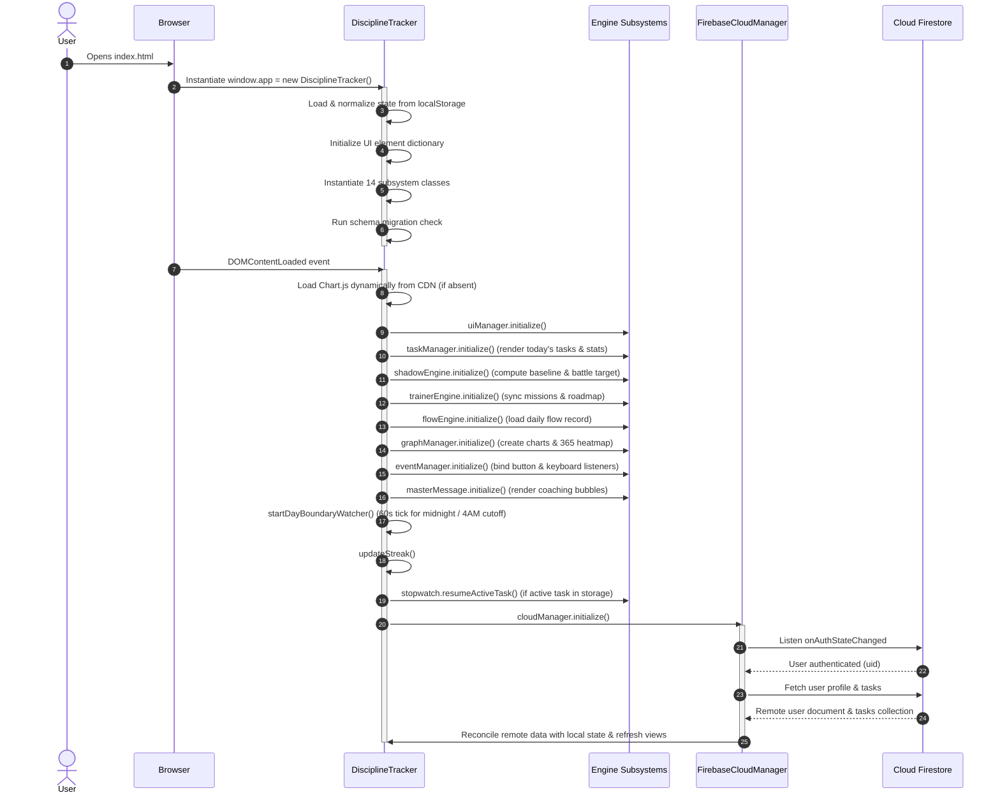
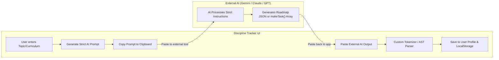

# System Architecture Documentation

Discipline Tracker Pro is a high-performance, offline-first personal discipline and study tracking web application built with vanilla web technologies (HTML5, CSS3, ES6+ JavaScript), backed by Google Authentication and Firebase Firestore.

---

## 1. Architectural Philosophy & Principles

1. **Vanilla Web Foundations**: Zero build-step requirement. The application executes natively in modern web browsers without Vite, Webpack, or Babel transforms.
2. **Single Runtime Source of Truth**: All core runtime orchestration, business logic, state management, and rendering pipelines are centralized in [assets/js/app.js](file:///d:/Programme/Html/Discipline-main/assets/js/app.js) to prevent state fragmentation and split-brain desynchronization.
3. **Offline-First with Seamless Cloud Durability**: The application remains fully functional offline using browser `localStorage` and Firestore's IndexedDB persistence layer. When authenticated and online, mutations are debounced and synced to Firebase.
4. **Deterministic Calculation Invariants**: Metrics across SHADOW Buddy, analytics charts, the 365-day heatmap, and streak counters derive from identical normalization helpers and day-boundary cutoff rules.
5. **Defensive Data Handling & Security**: Malformed storage entries or import files are sanitized or discarded defensively, and user-provided inputs are strictly escaped before DOM interpolation.

---

## 2. High-Level System Architecture

```mermaid
graph TD
    subgraph Client ["Client Browser Runtime"]
        subgraph Presentation ["Presentation Layer"]
            HTML["App Shell (index.html)"]
            CSS["Stylesheet (assets/css/app.css)"]
            Banner["Update Check Banner (update-check.js)"]
        end

        subgraph ExternalLibs ["External Vendor Dependencies (CDN)"]
            ChartJS["Chart.js (CDN)"]
            SheetJS["SheetJS / xlsx.full.min.js (CDN)"]
            FontAwesome["FontAwesome 6 (CDN)"]
        end

        subgraph CoreApp ["Central Orchestration (assets/js/app.js)"]
            DisciplineTracker["DisciplineTracker (App Controller)"]

            subgraph DataSubsystems ["Time & Activity Subsystems"]
                Stopwatch["StopwatchManager"]
                TaskManager["TaskManager"]
                Classifier["ActivityClassifier"]
            end

            subgraph BehavioralSubsystems ["Behavioral & Game Engines"]
                Shadow["ShadowEngine (Antagonist AI)"]
                Flow["FlowProtocolEngine (Deep Work)"]
                Trainer["TrainerEngine (Roadmap & Missions)"]
                MasterMsg["MasterMessageManager (Coach Bubbles)"]
            end

            subgraph VisualSubsystems ["Visualization & Reporting"]
                Graph["GraphManager (Charts & 365 Heatmap)"]
                Analytics["AnalyticsService"]
                ExcelGen["ExcelReportGenerator"]
                UI["UIManager (Modals & Screensaver)"]
                Events["EventManager (DOM Wiring)"]
            end

            subgraph SyncSubsystems ["Sync & Persistence Subsystems"]
                SyncMgr["SyncManager (Queue & Offline Flush)"]
                CloudMgr["FirebaseCloudManager (Firestore Integration)"]
            end
        end

        subgraph LocalStorageTier ["Browser Storage"]
            LocalStorage[("window.localStorage")]
            SessionStorage[("window.sessionStorage")]
            IndexedDBStorage[("Firestore IndexedDB Cache")]
        end

        subgraph AuthAndCloud ["Cloud & Auth Modules"]
            GoogleAuth["GoogleAuthModule (google-auth.js)"]
            FirebaseService["FirebaseServices (firebase-service.js)"]
        end
    end

    subgraph FirebaseCloud ["Google Firebase Infrastructure"]
        FirebaseAuth["Firebase Authentication (Google OAuth)"]
        Firestore["Cloud Firestore Database"]
    end

    %% Wiring
    HTML --> DisciplineTracker
    CSS --> HTML
    Banner --> HTML

    DisciplineTracker --> Stopwatch
    DisciplineTracker --> TaskManager
    DisciplineTracker --> Classifier
    DisciplineTracker --> Shadow
    DisciplineTracker --> Flow
    DisciplineTracker --> Trainer
    DisciplineTracker --> MasterMsg
    DisciplineTracker --> Graph
    DisciplineTracker --> Analytics
    DisciplineTracker --> ExcelGen
    DisciplineTracker --> UI
    DisciplineTracker --> Events
    DisciplineTracker --> SyncMgr
    DisciplineTracker --> CloudMgr

    Graph -.-> ChartJS
    ExcelGen -.-> SheetJS

    DisciplineTracker <--> LocalStorage
    Stopwatch <--> SessionStorage
    CloudMgr <--> FirebaseService
    CloudMgr <--> GoogleAuth

    GoogleAuth <--> FirebaseAuth
    FirebaseService <--> Firestore
    FirebaseService <--> IndexedDBStorage
```



---

## 3. Runtime Entrypoints & Initialization Lifecycle

### 3.1 Script Loading Order
The application shell defined in [index.html](file:///d:/Programme/Html/Discipline-main/index.html) loads scripts at the end of the `<body>`:

1. [update-check.js](file:///d:/Programme/Html/Discipline-main/update-check.js): Standalone script displaying the latest GitHub commit timestamp.
2. `xlsx.full.min.js`: Deferred SheetJS library for exporting Excel workbooks.
3. [firebase-service.js](file:///d:/Programme/Html/Discipline-main/firebase-service.js) (`type="module"`): Initializes Firebase SDK, enables offline IndexedDB persistence, and exposes `window.FirebaseServices`.
4. [google-auth.js](file:///d:/Programme/Html/Discipline-main/google-auth.js) (`type="module"`): Encapsulates mobile redirect vs. desktop popup OAuth flows and exposes `window.GoogleAuthModule`.
5. [assets/js/app.js](file:///d:/Programme/Html/Discipline-main/assets/js/app.js) (`type="module"`): Primary application entrypoint.

### 3.2 Bootstrap Sequence



### 3.3 Visibility and Lifecycle Handlers
- **`visibilitychange`**: When returning to the browser tab, the application triggers `taskManager.updateStats()`, `taskManager.renderTasks()`, `shadowEngine.refresh(false)`, `trainerEngine.syncMissionFromRoadmap()`, and `masterMessage.render()`.
- **`beforeunload`**: Safely clears the stopwatch interval timer.
- **`startDayBoundaryWatcher()`**: Evaluates every 60 seconds whether the calendar day or the SHADOW cutoff boundary (04:00 AM) has elapsed, triggering automatic view refreshes when days roll over.

---

## 4. Subsystems Breakdown & Active Runtime Ownership

All active runtime logic is implemented across 15 modular classes in [assets/js/app.js](file:///d:/Programme/Html/Discipline-main/assets/js/app.js):

| Class | Line | Primary Responsibility | Key Collaborators / Dependencies |
| :--- | :--- | :--- | :--- |
| `ActivityClassifier` | `L315` | Deterministic parsing of task names into categorized activities using keyword dictionaries (`CATEGORY_DEFINITIONS`, `CATEGORY_ALIASES`, `PRODUCTIVE_CATEGORIES`). | Used by `StopwatchManager`, `TaskManager`. |
| `SyncManager` | `L448` | Manages local offline sync queues, detects online/offline browser state, and coordinates batch flushes. | `DisciplineTracker`, `FirebaseCloudManager`. |
| `FirebaseCloudManager` | `L510` | Handles Google OAuth state listeners, Firestore document/subcollection reads/writes, throttling, write-debouncing, and stats resets. | `window.FirebaseServices`, `window.GoogleAuthModule`. |
| `DisciplineTracker` | `L1389` | Central coordinator; holds application `state`; executes `localStorage` serialization; provides HTML sanitization (`escapeHtml`), date formatting, and duration formatting. | Root parent of all subsystem managers. |
| `StopwatchManager` | `L2070` | Manages active timer state, start/pause/resume/finish transitions, and sleep-tracking mode. | `TaskManager`, `DisciplineTracker.state.activeTask`. |
| `TaskManager` | `L2397` | Task CRUD operations, task day-grouping, filtering by productive/distraction categories, task normalization (`normalizeTask`), and favorites management. | `ActivityClassifier`, `DisciplineTracker.state.tasks`. |
| `AnalyticsService` | `L2848` | Aggregates monthly performance records, category distributions, distraction breakdowns, and historical reporting stats. | `TaskManager`, `DisciplineTracker.state.tasks`. |
| `UIManager` | `L3088` | Controls application modals (Report, Pipeline Trainer, Streak Popup), updates digital clock headers, rotates motivational quotes, and runs the 15-minute idle screensaver. | `DisciplineTracker.elements`. |
| `ShadowEngine` | `L3901` | Core antagonist AI engine: calculates rolling 7-day baselines, battle targets, momentum deltas, rank progression (Stinger to Apex), and the 10-day Training Camp. | `TaskManager`, `GraphManager`. |
| `TrainerEngine` | `L5887` | Manages study roadmaps, milestone tracking, prompt generation for external AI, task code parsing (`parseTaskPlanCode`), and Daily Mission population. | `TaskManager`, `ShadowEngine`. |
| `FlowProtocolEngine` | `L7876` | Manages deep-work flow sessions, war-mode tracking, and daily focus score records. | `TaskManager`, `StopwatchManager`. |
| `GraphManager` | `L8118` | Integrates with Chart.js to render Productivity and Sleep charts; renders the 365-day GitHub-style interactive contribution heatmap with win/loss targets. | `Chart.js`, `ShadowEngine`, `TaskManager`. |
| `EventManager` | `L10218` | Centralizes DOM event binding for buttons, inputs, date pickers, hotkeys, and modals. | `DisciplineTracker.elements`. |
| `ExcelReportGenerator` | `L10516` | Generates multi-sheet Excel reports (Summary, Task History, Analytics) via SheetJS. | `window.XLSX`, `AnalyticsService`. |
| `MasterMessageManager` | `L10753` | Generates personalized coaching messages, simulates live typing animations, and evaluates timetable adherence against current clock time. | `ShadowEngine`, `TrainerEngine`. |

---

## 5. State Management & Storage Schema

### 5.1 Storage Keys Reference
All browser `localStorage` keys are formally declared under `CONFIG.STORAGE_KEYS`:

| Key Name | Storage Key | Content Type | Description |
| :--- | :--- | :--- | :--- |
| `TASKS` | `discipline_tracker_tasks` | `Array<Task>` | Complete normalized task history. |
| `FAVORITES` | `discipline_tracker_favorites` | `Array<Favorite>` | Quick-access favorite task presets. |
| `STREAK` | `discipline_tracker_streak` | `Number` | Current unbroken daily productive streak. |
| `LAST_ACTIVITY` | `discipline_tracker_last_activity` | `String (YYYY-MM-DD)` | Last date on which productive time was logged. |
| `ACTIVE_TASK` | `discipline_tracker_active_task` | `Object` or `null` | Snapshot of the active stopwatch task for reload restoration. |
| `SCHEMA_VERSION` | `discipline_tracker_schema_version` | `Number` | Database schema version (currently `2`). |
| `SYNC_ENDPOINT` | `discipline_tracker_sync_endpoint` | `String` | Configured remote sync endpoint. |
| `SYNC_DEVICE_ID` | `discipline_tracker_device_id` | `String (UUID)` | Unique client device identifier. |
| `SYNC_QUEUE` | `discipline_tracker_sync_queue` | `Array<SyncAction>` | Offline mutations queued for remote flush. |
| `SHADOW_AVG` | `discipline_tracker_shadow_avg` | `Number` | Cached baseline average minutes for SHADOW. |
| `TRAINER_STATE` | `discipline_tracker_trainer_state` | `Object` | Active roadmap progress, mission statuses, and checkmarks. |
| `FLOW_PROTOCOL` | `discipline_tracker_flow_protocol` | `Object` | Historical flow protocol and deep-work state by date. |
| `ROADMAP_STATE` | `discipline_tracker_roadmap_state` | `Object` | User-defined study roadmap hierarchy and modules. |
| `JOURNAL_ENTRIES` | `discipline_tracker_journal_entries` | `Object` | Daily sleep journal notes, mood, and tomorrow goals. |
| `FIREBASE_USER` | `discipline_tracker_firebase_user` | `Object` | Cached authenticated user metadata. |
| `CLIENT_VERSION` | `discipline_tracker_client_version` | `String` | Client version stamp (`2026.03.12.3`). |
| `TIMER_CLOUD_STATE` | `discipline_tracker_timer_cloud_state` | `Object` | Cloud-synced active timer timestamp for cross-device tracking. |
| `SHADOW_ENGINE_STATE` | `discipline_tracker_shadow_engine_state` | `Object` | Rank tiers, camp trials, and behavioral state history. |
| `ROADMAP_PROMPT_DRAFT` | `discipline_tracker_roadmap_prompt_draft` | `String` | User-specific draft prompt for external AI roadmap generator. |
| `ROADMAP_RESPONSE_DRAFT`| `discipline_tracker_roadmap_response_draft`| `String` | Raw JSON response pasted from external AI for roadmap. |
| `TASK_PROMPT_DRAFT` | `discipline_tracker_task_prompt_draft` | `String` | User-specific draft prompt for external AI task generator. |
| `TASK_RESPONSE_DRAFT` | `discipline_tracker_task_response_draft` | `String` | Raw `makeTask(...)` code pasted from external AI. |
| `SPIRAL_HABIT_TRACKER` | `discipline_tracker_spiral_habit_tracker` | `Object` | Habit recurrence tracking state. |
| `STATS_RESET_AT` | `discipline_tracker_stats_reset_at` | `Number (epoch ms)` | Boundary timestamp; tasks before this are excluded from stats. |

### 5.2 Storage Integrity & Defensive Fallback
- **Parsing Guardrails**: `DisciplineTracker.prototype.loadFromStorage(key)` wraps `JSON.parse` in a `try...catch`. If corrupted data is detected, the key is defensively removed via `localStorage.removeItem(key)` and `null` is returned to prevent app crashes.
- **Selective Stats Reset**: `DisciplineTracker.prototype.completeResetData()` allows users to reset streaks, journal entries, shadow metrics, and flow records while preserving task history and the master study roadmap.

---

## 6. Firebase Cloud Synchronization & Authentication

### 6.1 Authentication Architecture
Authentication is isolated in [google-auth.js](file:///d:/Programme/Html/Discipline-main/google-auth.js):
- **Desktop Clients**: Executes `signInWithPopup(auth, provider)` with `select_account` prompt.
- **Mobile Clients**: Automatically falls back to `signInWithRedirect(auth, provider)` to avoid mobile popup blockers.
- **Origin Check**: Automatically disables login on `file://` URLs, requiring an HTTP(S) host.

### 6.2 Firestore Data Model

```
firestore
├── users/
│   └── {uid}/
│       ├── (user document: email, displayName, streak, clientVersion,
│       │    roadmapPromptDraft, roadmapResponseDraft, taskPromptDraft, taskResponseDraft)
│       │
│       ├── tasks/
│       │   └── {taskId}/
│       │       ├── id: string
│       │       ├── name: string
│       │       ├── category: string
│       │       ├── duration: number (minutes)
│       │       ├── startTime: number (epoch ms)
│       │       ├── endTime: number (epoch ms)
│       │       ├── date: string (YYYY-MM-DD canonical)
│       │       └── isProductive: boolean
│       │
│       └── state/
│           ├── trainer_state
│           ├── roadmap_state
│           ├── flow_protocol
│           └── journal_entries
```

### 6.3 Firebase Protection & Throttling
To protect against runaway Firestore write costs and API rate limits, `CONFIG.FIREBASE_PROTECTION` enforces:
- `MAX_WRITES_PER_MINUTE`: 60 writes/min maximum.
- `WRITE_DEBOUNCE_MS`: 1200ms debounce buffer on document saves.
- `MAX_TASKS_SYNC`: Caps initial sync payload to 2,000 tasks.
- `MAX_FAVORITES_SYNC`: Caps favorites sync to 200 items.
- `MAX_TEXT_LEN`: Rejects task labels exceeding 180 characters.
- `MIN_MISSION_UPDATE_INTERVAL_MS`: 2500ms minimum interval between cloud mission checks.

---

## 7. Core Calculation & Synchronization Contracts

### 7.1 Day Cutoff & Date Normalization
A critical domain rule in this application is the early-morning cutoff hour:
- **`CONFIG.SHADOW_DAY_CUTOFF_HOUR = 4` (04:00 AM)**:
  - Any study session logged between midnight and 03:59:59 AM is grouped into the **previous calendar day's SHADOW battle and daily productive total**.
  - This ensures night owls and late-night study sessions are credited to the active work day rather than prematurely resetting the new day.
- Canonical task dates are constructed in `normalizeTask()` strictly from `task.startTime` using `getDateString()`.

### 7.2 SHADOW Engine 2.0 Math & Battle System
The SHADOW Engine simulates an antagonist baseline reflecting the user's past performance:

1. **Daily Productive Minutes**: Calculated via `getDailyProductiveMap()`, aggregating only tasks where `isProductiveCategory(task.category)` is true.
2. **Rolling Baseline (`shadow-average`)**: Computed across the preceding 7 days using `getHistoricalLockedShadowMap()`.
3. **Win Target**:
   $$\text{Win Target} = \text{Shadow Target} + 1\text{ minute}$$
4. **Battle Verdict**:
   - $\text{Productive Minutes} > \text{Shadow Target} \implies \textbf{WIN}$
   - $\text{Productive Minutes} = \text{Shadow Target} \implies \textbf{TIE}$
   - $\text{Productive Minutes} < \text{Shadow Target} \implies \textbf{LOSS}$
5. **Ranks & Training Camp**:
   - Progression tiers: *Stinger* (0m) $\rightarrow$ *Operator* (180m) $\rightarrow$ *Specialist* (240m) $\rightarrow$ *Vanguard* (300m) $\rightarrow$ *Centurion* (360m) $\rightarrow$ *Titan* (420m) $\rightarrow$ *Apex* (480m).
   - Training Camp: When advancing, a provisional rank is granted. The user must win at least **7 out of 10 consecutive days** to solidify the promotion.

### 7.3 Cross-Subsystem Alignment Invariants
To prevent data discrepancies across UI sections, the following invariants are strictly enforced:

> [!IMPORTANT]
> **Data Synchronization Rules (see [CHANGE_RULES.md](file:///d:/Programme/Html/Discipline-main/CHANGE_RULES.md))**:
> - `Shadow Buddy` baseline value **must exactly match** `GraphManager` today shadow baseline.
> - `Shadow Buddy` baseline value **must exactly match** the `365 Heatmap` cell tooltip `Shadow` value.
> - `365 Heatmap` tooltip `Win Target` **must always equal** $\text{Shadow} + 1\text{ minute}$.
> - Future calendar dates on the 365-day heatmap must never render as active streak cells.
> - Momentum delta indicators must be formatted once only; never duplicate deltas across render calls.

---

## 8. Trainer Engine & AI Generator Pipeline

The application features a semi-automated prompt generation and code integration pipeline inside the Trainer modal (`<details class="generator-panel">`):



### 8.1 Roadmap vs. Task Generation Cards
1. **Roadmap Generator Card**: Produces structured JSON detailing modules, topics, and checkpoints; saved into `CONFIG.STORAGE_KEYS.ROADMAP_STATE`.
2. **Task Format Generator Card**: Incorporates the active roadmap context to generate executable JavaScript task definitions:
   ```javascript
   return [
     makeTask("ANALOG SET 1", "Important Concepts of MOS Physics", [6.25, 8.25], "HIGH", "STRICT", 120, "Core Study", false, 11),
     makeTask("ANALOG SET 2", "Small Signal Analysis", [9.0, 11.0], "HIGH", "STRICT", 120, "Core Study", false, 11)
   ];
   ```

### 8.2 Task Parser & Mission Precedence
- The parser (`parseTaskPlanCode()`) employs a specialized tokenizer (`splitTaskFunctionArgs`, `parseTaskValueToken`, `parseTaskWinToken`) that validates parameters without running arbitrary `eval()`.
- **Mission Precedence in `getDailyMissionTasks()`**:
  1. If `CONFIG.STORAGE_KEYS.TASK_RESPONSE_DRAFT` contains valid parsed task definitions, those tasks populate the **Daily Mission**.
  2. If absent or invalid, the app falls back to the default study schedule.

---

## 9. Historical Refactoring Log & Key Decisions

### 9.1 Elimination of Parallel Duplicate Sidecars
- **Historical Problem**: Previous iterations introduced duplicate helper modules under `core/`, `services/`, `ui/`, `analytics/`, `shadow-engine/`, `trainer/`, and `execution/`. Because these sidecars duplicated methods from [assets/js/app.js](file:///d:/Programme/Html/Discipline-main/assets/js/app.js) without being the true runtime target, changes made to one file did not reflect in the application, leading to state desynchronization.
- **Architectural Resolution**: All duplicate sidecar files were removed. [assets/js/app.js](file:///d:/Programme/Html/Discipline-main/assets/js/app.js) is the single active runtime implementation.

### 9.2 Removal of Experimental AI Modules (Commit `c004194`)
- **Historical Problem**: Experimental local AI modules (`modules/chat.js`, `modules/notes.js`, `modules/parser.js`, `modules/planner.js`, `modules/insights.js`, `modules/validator.js`) introduced complex Ollama and IndexedDB dependencies that compromised the stability and performance of the core tracker.
- **Architectural Resolution**: All experimental AI modules were removed to restore the original, highly reliable tracker architecture. The `modules/` directory is currently retained as an empty folder.

### 9.3 Strict Rules for the `modules/` Directory
- The `modules/` folder is reserved strictly for **future clean domain extractions**.
- **Extraction Rules**:
  - Do not introduce partial duplicate sidecar modules.
  - An extraction must move a complete domain slice out of [assets/js/app.js](file:///d:/Programme/Html/Discipline-main/assets/js/app.js) and establish a single active source of truth.
  - Code changes must be validated with `node --check assets/js/app.js` and confirmed in the browser.

---

## 10. Security Invariants & Defensive Engineering

1. **DOM Cross-Site Scripting (XSS) Prevention**:
   - User-supplied task names, categories, favorite labels, and dynamic report strings are passed through `DisciplineTracker.prototype.escapeHtml()` prior to DOM interpolation:
     ```javascript
     escapeHtml(value = "") {
       return String(value)
         .replace(/&/g, "&amp;")
         .replace(/</g, "&lt;")
         .replace(/>/g, "&gt;")
         .replace(/"/g, "&quot;")
         .replace(/'/g, "&#39;");
     }
     ```
2. **Defensive Storage Deserialization**:
   - Storage retrieval operations wrap `JSON.parse` in isolated error-handling blocks. Corrupted keys are purged immediately without interrupting application bootstrap.
3. **Import Payload Validation**:
   - The data import pipeline validates file size boundaries (rejecting oversized files), checks JSON structure, and ignores non-object array entries prior to normalization.

---

## 11. Engineering Guidelines for Future Modifications

When making changes to this codebase, follow the systematic workflow detailed in [CHANGE_RULES.md](file:///d:/Programme/Html/Discipline-main/CHANGE_RULES.md):

1. **Trace Dependencies First**: Identify all call sites of a target helper using ripgrep (`rg`) or PowerShell.
2. **Map Connected DOM Elements**: Identify every UI element updated by the calculation.
3. **Update Shared Calculations**: Never patch displayed text in isolation. Fix the underlying helper in [assets/js/app.js](file:///d:/Programme/Html/Discipline-main/assets/js/app.js).
4. **Syntax Validation**: Validate code syntax before browser testing:
   ```powershell
   node --check assets/js/app.js
   ```
5. **Verify Alignment**: Verify that the top day stats, SHADOW Buddy card, productivity chart line, and 365 heatmap tooltips match.
